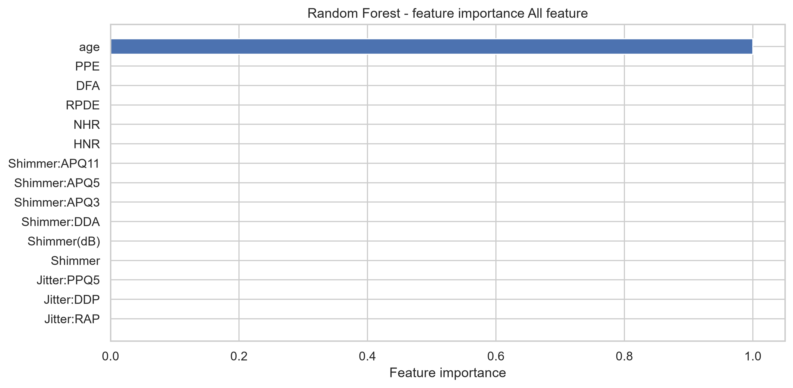
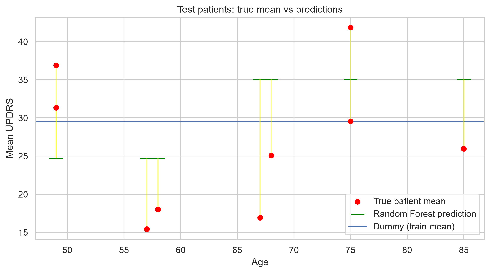

# Can voice recordings predict Parkinson's severity in a new patient?

A patient-level evaluation of regression models on the UCI Parkinson's Telemonitoring dataset.

## TL;DR

- **Question:** can voice measurements from a home telemonitoring device predict a new patient's `total_UPDRS` score?
- **Answer:** no. Voice features carry no usable signal for unseen patients, either across patients or within a patient over time.
- **Only `age` helps (weakly):** it improved cross-validated RMSE by about 1 point, but the gain did not hold on 9 held-out patients (the age-only forest was 0.9 RMSE points worse than predicting the training mean).
- **Main methodological point:** the dataset has 5,863 recordings but only 42 patients. Splitting by row instead of by patient leaks patient identity into the test fold and makes models look useful when they are not.

## Dataset

[UCI Parkinson's Telemonitoring](https://archive.ics.uci.edu/dataset/189/parkinsons+telemonitoring): 42 patients with early-stage Parkinson's, about 6 months of at-home recordings, 5,863 recordings in total (about 140 per patient).

| Group | Columns |
|---|---|
| Demographics | `age`, `sex` |
| Time | `test_time` (days since recruitment) |
| Voice (16) | Jitter (5 variants), Shimmer (6 variants), NHR, HNR, RPDE, DFA, PPE |
| Target | `total_UPDRS` |

`motor_UPDRS` is dropped from the inputs and not used as a target: total UPDRS is the sum of Parts I, II and motor (Part III), and the two scores correlate above 0.9, so keeping it would leak the answer.

Source: Tsanas, Little, McSharry, Ramig (2010), *Accurate telemonitoring of Parkinson's disease progression by non-invasive speech tests*, IEEE Trans. Biomed. Eng.

## Method

**Patient-level splitting everywhere**
- Hold-out test set: `GroupShuffleSplit`, 80/20 by patient (33 train / 9 test patients, 4,628 / 1,235 rows, no patient overlap).
- Cross-validation on the training set: `GroupKFold(5)`, which is deterministic, so per-fold comparisons between models are paired.
- Train/test balance was checked with standardized mean differences. `DFA` shows the largest shift (SMD about 0.95), and the test set contains no severe patients.

**Preprocessing (linear models).** Log transform only on the skewed columns (Jitter, Shimmer, NHR), standardization, and one PCA component per correlated feature family (Jitter, Shimmer). Everything is fit inside a `Pipeline`/`ColumnTransformer`, so each CV fold fits its own transforms. `test_time` is ablated because it carries no information about a new patient.

**Baseline.** A `DummyRegressor` that predicts the training mean. Its RMSE is about the target's standard deviation (about 10.75 in CV) and every model has to beat it.

**Models.**  Linear regression, ridge, and `RandomForestRegressor` with large `min_samples_leaf` as the main regularizer.

## Findings

### 1. Row-level splitting leaks patient identity

The same linear model and features, evaluated with two CV schemes:

| CV scheme | Linear RMSE | Linear R² | Dummy RMSE |
|---|---|---|---|
| Shuffled `KFold` (rows) | 9.86 | 0.20 | 11.04 |
| `GroupKFold` (patients) | 10.70 | -0.01 | 10.75 |

Under row-level CV the model looks useful; under patient-level CV it is no better than the mean. RMSE is compared across schemes rather than R², because the folds differ and so does the target variance in each fold (the dummy's RMSE is 11.04 vs 10.75).

For random forests the mechanism is memorization: with fully grown trees a leaf can isolate a single patient, whose neighboring recordings are in the training fold. A leaf must contain more rows than one patient contributes (about 140) to stop this. With min_samples_leaf=1000, which was selected from a leaf-size sweep on the training folds, the two CV schemes agree (RMSE 9.755 vs 9.753), so the forest can no longer exploit patient identity. The cost is a very coarse model.

| CV scheme | Random Forest RMSE |
|---|---|
| Shuffled `KFold` (rows) | 9.753 | 
| `GroupKFold` (patients) | 9.755 | 

### 2. Only demographics carry (a weak) signal

Mean RMSE across the 5 patient-level folds:

| Features | Random forest RMSE | vs dummy (10.75) |
|---|---|---|
| All (no `test_time`) | 9.76 | -1.0 (4 of 5 folds better) |
| Demographics only (`age`, `sex`) | 9.76 (within 0.03 per fold) | same |
| Voice only (best leaf, 1500) | 10.75 | 0.0 |

- The all-features forest and the demographics-only forest are essentially the same model: `age` accounts for about 100% of the feature importance, and the voice columns for about 0.
- Voice-only is worse than the dummy at small leaf sizes (RMSE 11.95 at `min_samples_leaf=1`) and converges to the dummy as the leaf grows, meaning the forest learns to ignore the voice and predict the mean.



### 3. Voice does not track change within a patient either

Telemonitoring is often about change over time, which is a different question from comparing patients. After subtracting each patient's own mean from the voice columns and from `total_UPDRS`:

- Every voice feature has |r| ≤ 0.07 with the score. `test_time` has r = 0.46.
- A linear model on `test_time` alone reaches within-patient R² = 0.178 under `GroupKFold`. Adding the 16 voice features lowers it to 0.152.

So the only clear progression signal is time itself, and using it for a new patient would require a known baseline. (This is a descriptive analysis: the demeaning uses each patient's own mean, which a deployed model would not have.)

### 4. Held-out test set (9 patients, used once)

| Model | RMSE | MAE | R² |
|---|---|---|---|
| Dummy (train mean) | 9.47 | 7.99 | -0.08 |
| Random forest, `age` + `sex`, leaf 1000 | 10.39 | 9.33 | -0.30 |

The forest is worse than the baseline. It learned a single age split with a gap of about 10 UPDRS points between younger and older patients; in the 9 test patients the gap is about 2.5. The direction held, the magnitude did not. It beats the dummy on 3 of 9 patients (mean per-patient absolute error 9.4 vs 7.5).



The test result is not inconsistent with the CV result: with 9 patients and a between-patient standard deviation of about 10 points, a group gap has a standard error of 6 to 7 points. The honest reading is that the age effect is **small and unstable at this sample size**, not that it is absent or proven.

## Conclusions

1. Voice features from this device do not predict `total_UPDRS` for unseen patients, between or within patients.
2. A small age effect appears in cross-validation but does not survive a 9-patient hold-out.
3. Most of the variance in UPDRS lies between patients and is not explained by any feature in the dataset.
4. Patient-level splitting changes the conclusion. Row-level evaluation would have reported a model with R² ≈ 0.2.

## Limitations

- 42 patients in total. The test set has 9, no severe cases, and a shifted `DFA` distribution.
- A single train/test split and no confidence intervals.
- Hyperparameters (`min_samples_leaf`) were chosen by CV on the training set only; the test set was evaluated once and not tuned on.
- Linear-model ablation results (voice-only, demographics-only) are not reported here.

## Possible extensions

- **Personalized baseline:** give the model each new patient's first few recordings, then predict later ones. This is closer to real telemonitoring, and voice or time might add value there.
- Bootstrap over patients for uncertainty on the test comparison.
- Gradient boosting with comparable regularization as a sanity check, and a neural-network comparison.

## Reproducing

```bash
pip install -r requirements.txt
# download parkinsons_updrs.data from the UCI link above into data/
jupyter notebook Parkinson_s_telemonitoring_project.ipynb
```
Python 3.12

Random seeds are fixed (`random_state=42`); `GroupKFold` is deterministic.
